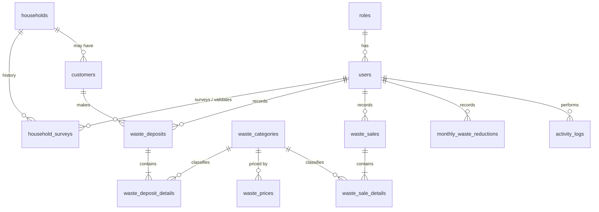

# Database Schema — Bank Sampah

Source of truth is `database/migrations/`. This document is the human-readable summary the team agrees on **before** building modules.

## ERD

`settings` (key/value) has no relations.

## Tables by module

| Module | Table | Purpose |
| --- | --- | --- |
| Foundation | `roles` | super_admin, admin, officer, viewer |
| Foundation | `users` (altered) | adds `role_id`, `phone`, `is_active`, `locale`, `theme`, `last_login_at` |
| Master data | `households` | Data Rumah; `sorting_status` = current status |
| Master data | `customers` | Data Nasabah; optional link to a household |
| Master data | `waste_categories` | Jenis Sampah |
| Master data | `waste_prices` | Harga Sampah, one row per price change |
| Pendataan | `household_surveys` | Survey history + validation workflow |
| Transaksi | `waste_deposits` / `waste_deposit_details` | Setoran (header / items) |
| Transaksi | `waste_sales` / `waste_sale_details` | Penjualan (header / items) |
| Monitoring | `monthly_waste_reductions` | One row per year+month |
| System | `activity_logs`, `settings` | Audit trail, app settings |

## Conventions

- **Status columns are strings, not MySQL ENUMs** (easier to change later). Validate allowed values in the app.
  - `households.sorting_status`: `unknown | sorting | not_sorting`
  - `household_surveys.sorting_status`: `sorting | not_sorting`
  - `household_surveys.validation_status`: `pending | validated | rejected`
- **Soft deletes** on `households`, `customers`, `waste_deposits`, `waste_sales`.
- **Price snapshots**: detail rows store `price_per_unit` at transaction time, so later price changes never alter past transactions.
- **Totals** (`total_weight`, `total_amount`) on headers are denormalized for fast reports; recompute them in one service when details change.
- **Delete rules**: history/transaction references use `RESTRICT`; "who did it" user references use `SET NULL`; detail rows `CASCADE` with their header.
- **Weights** are `decimal(12,3)` (kg), **money** is `decimal(15,2)` (Rupiah).

## Assumptions to confirm as a team

1. A customer (nasabah) can optionally link to a household (`customers.household_id` nullable).
2. Deposits are valued at the price effective on the deposit date. No withdrawal / saldo table yet.
3. Sale buyers are free text (`buyer_name`), not a master table.
4. `households.sorting_status` is updated when a survey is **validated**.
5. Role/permission is a single role per user (no separate permissions table).
